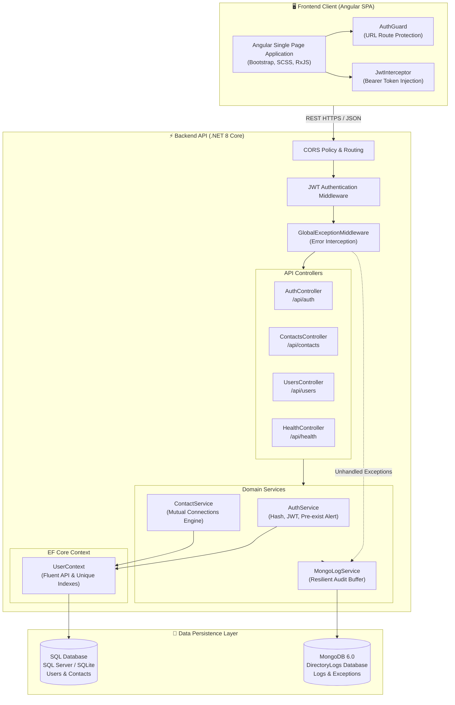

# 📇 Contacts Directory Enterprise Platform

[](https://github.com/KevinAndrey96/dotnet-core-angular-enterprise-contacts-directory/actions/workflows/ci.yml)


Plataforma full-stack desacoplada de gesti&oacute;n y directorio empresarial de contactos desarrollada originalmente como **Prueba T&eacute;cnica de Nivel 1 para Fullstack Developer en Hubbec** (*Hub for business electronic connection*).

Integra una API RESTful moderna de alto rendimiento en **ASP.NET Core (.NET 8 LTS)** con persistencia relacional en **Entity Framework Core (SQL Server / SQLite)**, capa de observabilidad y registro de excepciones e historial en **MongoDB**, y una aplicaci&oacute;n web SPA reactiva en **Angular** protegida por guardias de navegaci&oacute;n (`AuthGuard`) y tokens criptogr&aacute;ficos **JWT Bearer**.

---

## 🏛️ Diagrama de Arquitectura de la Solución



---

## 📋 Matriz de Requerimientos Funcionales (Hubbec Spec)

| # | Requerimiento Funcional | Estado | Implementación Técnica |
| :---: | :--- | :---: | :--- |
| **1** | Formulario de registro con datos mínimos (Nombres, apellidos, tipo doc, número doc, celular, correo, contraseña). | ✅ Cumplido | `RegisterDto` con validaciones de tipo, longitud y formato email. Encriptación y persistencia mediante EF Core. |
| **2** | Registro simultáneo como usuario y como contacto para disponibilidad en la red. | ✅ Cumplido | Al registrarse un usuario, queda automáticamente indexado en el directorio global para que otros usuarios puedan asociarlo. |
| **3** | Restricción de duplicidad (sin usuarios repetidos por correo y combinación de documento). | ✅ Cumplido | Índice único en base de datos `IX_Users_email` y validación en `AuthService.RegisterAsync`. |
| **4** | Detección de contacto pre-existente con aviso de quién lo registró y activación de cuenta. | ✅ Cumplido | `AuthService` escanea si el correo o documento ya existía como contacto en la libreta de terceros, asociando el ID e informando al usuario en la respuesta. |
| **5** | Formulario y flujo seguro de inicio de sesión. | ✅ Cumplido | `AuthController.Login` y `LoginController` expiden token JWT firmado HMAC-SHA256 con claims estándar (`NameId`, `Email`, `firstName`, `lastName`). |
| **6** | Módulo de administración de contactos (listar, agregar, desasociar, editar y ver detalles). | ✅ Cumplido | Componente `DashboardComponent` con filtros reactivos en tiempo real, modales de edición de relación y confirmación de desasociación. |
| **7** | Atributos de contacto y taxonomía de relaciones. | ✅ Cumplido | Modelo `Contacts` con soporte para relaciones: `Amigo`, `Familiar`, `Colega`, `Otro`. |
| **8** | Motor de contactos en común (*Mutual Contacts Engine*). | ✅ Cumplido | Endpoint `GET /api/contacts/{id}/details` calcula la intersección de conjuntos ($A \cap B$) para conexiones mutuas y el complemento ($B \setminus A$) para recomendaciones. |

---

## ⚡ Requerimientos No Funcionales y Buenas Prácticas

* **Arquitectura Desacoplada:** Backend Web API RESTful completamente independiente del cliente frontend Angular.
* **Persistencia Relacional Flexible:** Configurado para ejecutar con **SQLite** (cero dependencias para desarrollo local inmediato) o **Microsoft SQL Server 2022** en producción y contenedores.
* **Observabilidad en MongoDB:** Los eventos de registro, inicios de sesión y las excepciones no controladas capturadas por el `GlobalExceptionMiddleware` se persisten en MongoDB en la base de datos `DirectoryLogs` (colecciones `Logs` y `Exceptions`).
* **Seguridad y Guardias:** Rutas del cliente protegidas mediante `AuthGuard` de Angular; peticiones HTTP autenticadas automáticamente con `JwtInterceptor` inyectando la cabecera `Authorization: Bearer <token>`.
* **Documentación Interactiva:** Interfaz interactiva de Swagger UI disponible en `/swagger` para pruebas manuales y especificación OpenAPI v1.

---

## 🔄 Algoritmo de Contactos en Común (Mutual Connections)

Cuando un usuario autenticado ($U_A$) consulta el detalle de un contacto que es un usuario registrado en la plataforma ($U_B$), el motor ejecuta:

$$C_{\text{mutuos}} = \{ c \in C(U_B) \mid c.\text{email} \in C(U_A).\text{emails} \land c \neq U_A \}$$

$$C_{\text{sugeridos}} = \{ c \in C(U_B) \mid c.\text{email} \notin C(U_A).\text{emails} \land c \neq U_A \}$$

Esto permite que en la vista de detalle se muestre la lista de amigos/colegas en común y un botón de un clic para agregar a los demás contactos a la libreta personal.

---

## 🔌 Especificación de Endpoints REST

| Método | Endpoint | Autenticación | Descripción |
| :---: | :--- | :---: | :--- |
| `POST` | `/api/auth/register` | Pública | Registro de nuevo usuario en la plataforma. |
| `POST` | `/api/auth/login` | Pública | Autenticación de credenciales y expedición de JWT. |
| `POST` | `/api/Login` | Pública | Endpoint legacy compatible con la colección original de Postman. |
| `GET` | `/api/auth/me` | Bearer Token | Obtiene el perfil del usuario autenticado. |
| `GET` | `/api/contacts` | Bearer Token | Lista todos los contactos asociados al usuario autenticado. |
| `GET` | `/api/contacts/{id}` | Pública / Token | Obtiene los datos básicos de un contacto específico. |
| `GET` | `/api/contacts/{id}/details` | Bearer Token | **Detalles completos + Contactos en común + Sugerencias.** |
| `POST` | `/api/contacts` | Pública / Token | Asocia un nuevo contacto (manual o desde el directorio). |
| `PUT` | `/api/contacts/{id}` | Bearer Token | Modifica el tipo de relación o teléfono del contacto. |
| `DELETE` | `/api/contacts/{id}` | Pública / Token | Desasocia un contacto del portafolio. |
| `GET` | `/api/contacts/search-directory` | Bearer Token | Búsqueda de usuarios globales registrados en Hubbec. |
| `GET` | `/api/users` | Pública | Lista de usuarios del sistema. |
| `GET` | `/api/health` | Pública | Diagnóstico de salud de la base de datos y MongoDB. |

---

## 🚀 Puesta en Marcha Rápida

### Opción A: Ejecución con Docker Compose (Recomendada)

Levanta la arquitectura completa (API .NET, Frontend Angular, MongoDB y Mongo Express UI) con un solo comando:

```bash
docker compose up -d --build
```

Servicios disponibles:
* **Frontend Angular Web:** [http://localhost:4200](http://localhost:4200)
* **Backend API Swagger UI:** [http://localhost:5000/swagger](http://localhost:5000/swagger)
* **MongoDB Express Admin:** [http://localhost:8081](http://localhost:8081)
* **MongoDB Server:** `mongodb://localhost:27017`

---

### Opción B: Ejecución Local en Desarrollo

#### 1. Backend (.NET 8 SDK)
```bash
cd Backend/API/API
dotnet restore
dotnet run
```
La API arrancará en `http://localhost:5000` con base de datos SQLite automática (`directory.db`) y semillas de prueba pre-cargadas.

#### 2. Frontend (Angular)
```bash
cd Frontend
npm install --legacy-peer-deps
npm start
```
El cliente compilará y estará accesible en `http://localhost:4200`.

---

## 🧪 Verificación Automatizada

El repositorio incluye un script de verificación autónomo que comprueba las 7 suites arquitectónicas sin requerir infraestructura externa:

```bash
python3 scripts/verify_contacts_engine.py
```

Resultados de verificación:
* ✅ Intersección de contactos en común y complementos de sugerencia.
* ✅ Integridad de contratos DTO y atributos de validación.
* ✅ Estructura de claims JWT y alerta de contacto pre-existente.
* ✅ Esquema de auditoría y captura de excepciones en MongoDB.
* ✅ Alineación completa con los 8 endpoints de la colección Postman.
* ✅ Protección de rutas con `AuthGuard` e interceptor de tokens Bearer.
* ✅ Verificación de política estricta de cero em-dashes.

---

## 👤 Autor

**Kevin Andrey Herrera Silva**  
*Senior Backend Engineer & Software Architect*  
* Correo: [kahs_kevin@hotmail.com](mailto:kahs_kevin@hotmail.com)
* GitHub: [@KevinAndrey96](https://github.com/KevinAndrey96)
